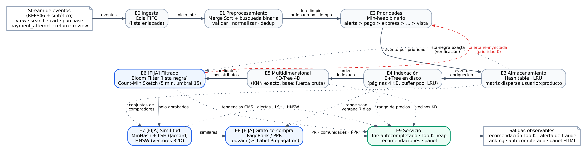

# EcoStream: pipeline de data streams con estructuras de datos avanzadas

**UTEC, Maestría en Ciencia de Datos e IA · Estructuras de Datos y Algoritmos 2026-2 · Prof. Heider Sánchez**
**Grupo 3** · Escenario **B: sistema de comercio electrónico**

Pipeline de **10 etapas** en el que cada etapa usa la estructura de datos más adecuada y su salida alimenta, de forma observable, a una etapa posterior: un evento de compra entra por una cola FIFO, se limpia y deduplica, se prioriza en un heap, se enriquece con tablas hash y caché LRU, se indexa en un B+Tree en disco, pasa por un filtro antifraude (Bloom Filter + Count-Min Sketch), alimenta los índices de similitud (MinHash+LSH, HNSW) y el grafo de co-compra (PageRank, Louvain), y termina en recomendaciones Top-K, autocompletado, alertas y un panel.



## Entregables

| Entregable | Ubicación |
|---|---|
| Informe PDF (8-12 páginas) | [`Proyecto_Final_Grupo3.pdf`](Proyecto_Final_Grupo3.pdf) (fuente LaTeX en `docs/informe/`) |
| Código fuente (estructuras propias + etapas + orquestador) | `src/ecostream/` |
| Diagrama del pipeline | `docs/diagrama_pipeline.{png,svg,pdf,dot}` |
| Notebooks ejecutados | `notebooks/01_demo_pipeline.ipynb`, `notebooks/02_resultados_experimentales.ipynb` |
| Demo de punta a punta (3-4 min) | `scripts/demo.py` → `docs/demo_output.txt`, `docs/dashboard.html` |
| Experimentos (1K a 10M) y resultados | `experiments/bench_*.py`, `experiments/results/*.csv`, `experiments/figures/*.png` |
| Pruebas de corrección | `tests/test_structures.py` (14 pruebas contra dict, heapq, bisect, fuerza bruta y networkx) |

## Tabla de roles y contribución individual

> Reemplazar "Integrante N" por los nombres reales. Cada integrante es **responsable principal** de al menos dos etapas o de una familia de algoritmos y expone esa parte. El historial de commits debe ser coherente con esta tabla (cada integrante sube los archivos de su parte desde su propia cuenta).

| Integrante | Responsable principal | Archivos | Aporte concreto | Expone |
|---|---|---|---|---|
| Integrante 1 | **E0 Ingesta, E1 Preprocesamiento, E2 Cola de prioridades** y generador del stream | `structures/linked_queue.py`, `sorting.py`, `heap.py`; `stages/s0-s2`; `data/generator.py`, `data/rees46_loader.py` | Cola FIFO con backpressure; Merge Sort estable + deduplicación por búsqueda binaria; heap con 9 clases de prioridad y medición de espera; generador vectorizado de 10M eventos con fraude, duplicados y registros sucios | Contexto, datos, E0–E2 y demo de prioridades |
| Integrante 2 | **E3 Almacenamiento/caché, E4 B+Tree, E5 KD-Tree** | `hash_table.py`, `lru_cache.py`, `sparse_matrix.py`, `bplus_tree.py`, `kd_tree.py`; `stages/s3-s5`; `bench_base.py` | Tabla hash con sondeo lineal; LRU O(1); matriz dispersa DOK→CSR; B+Tree paginado en disco con buffer pool; KD-Tree con KNN exacto y línea base; benchmarks de estructuras base | E3–E5, resultados de estructuras base |
| Integrante 3 | **Familias de filtrado probabilístico (E6) y similitud (E7)** | `bloom_filter.py`, `count_min_sketch.py`, `hashing.py`, `minhash_lsh.py`, `hnsw.py`; `stages/s6-s7`; `bench_prob.py`, `bench_similarity.py` | Bloom + verificación exacta; CMS con ventana deslizante, umbral y alertas re-inyectadas; MinHash+LSH en streaming y ajuste de (b, r); HNSW con heurística de vecinos; comparaciones contra exacto y fuerza bruta | E6–E7 y demo de filtrado y similitud |
| Integrante 4 | **Familias de influencia y comunidades (E8) y E9 Servicio**, orquestador | `graph/*.py`, `trie.py`; `stages/s8-s9`; `pipeline.py`, `dashboard.py`; `bench_graph.py`, `bench_pipeline.py`, `plots.py` | Grafo de co-compra desde el B+Tree; PageRank/PPR; Louvain vs Label Propagation (modularidad, estabilidad); Trie con top-K; recomendador Top-K; panel HTML; integración de punta a punta | E8–E9, demo del servicio y conclusiones |

Responsabilidades compartidas: informe (cada integrante redacta la investigación de su parte), notebooks y pruebas.

## Arquitectura

| Etapa | Bloque | Estructura / algoritmo (implementación propia) | Salida que alimenta a |
|---|---|---|---|
| E0 Ingesta | S1 | Cola FIFO con lista enlazada | micro-lotes → E1 |
| E1 Preprocesamiento | S2 | Merge Sort estable + búsqueda binaria (validar, normalizar, deduplicar) | lote limpio ordenado por tiempo → E2 |
| E2 Prioridades | S3 | Min-heap binario (alerta > pago > express/premium > estándar > programada > devolución > carrito > reseña > vista) | eventos por prioridad → E3 |
| E3 Almacenamiento | S4 | Tabla hash (sondeo lineal), LRU, matriz dispersa usuario×producto | evento enriquecido → E4; lista negra exacta → E6; conjuntos → E7 |
| E4 Indexación | S5 | B+Tree en disco (páginas de 4 KB + buffer pool LRU) | órdenes por tiempo (range scan) → E8; rango de precios → E9 |
| E5 Multidimensional | S6 | KD-Tree 4D + KNN exacto por fuerza bruta (línea base) | vecinos por atributos → E9 |
| **E6 Filtrado [FIJA]** | S7 | Bloom Filter (lista negra, verificación exacta) + Count-Min Sketch (ventana 5 min, umbral 15) | aprobado/bloqueado → E7, E8; alertas → E2 (prioridad 0) y panel |
| **E7 Similitud [FIJA]** | S7 | MinHash + LSH (Jaccard, b=32, r=2) y HNSW (vectores 32D) | productos similares → E9 |
| **E8 Grafo [FIJA]** | S8–S9 | Grafo de co-compra ponderado, PageRank / Personalized PageRank, Louvain (vs Label Propagation) | influencia, comunidades, PPR → E9 |
| E9 Servicio | Transversal | Trie con top-K por nodo, Top-K con heap, panel HTML | recomendación, autocompletado, tendencias, alertas |

**Definiciones del filtrado (exigidas por el enunciado):** clave = `payment_token` y `device_id` de cada intento de pago; ventana deslizante de 5 minutos (5 buckets de 60 s); umbral = más de 15 intentos en la ventana. Un positivo del Bloom se **verifica** contra la lista negra exacta (tabla hash) antes de bloquear.

## Instalación y ejecución en local

El proyecto se ejecuta en local; no requiere despliegue ni descargar datos (el stream se genera con semilla fija). Requiere **Python 3.11+**. Todos los comandos se ejecutan desde la raíz del repositorio.

### 1. Crear el entorno virtual e instalar dependencias (una sola vez)

Windows (PowerShell):

```powershell
python -m venv .venv
.\.venv\Scripts\Activate.ps1      # si se bloquea: Set-ExecutionPolicy -Scope CurrentUser RemoteSigned
pip install -r requirements.txt
```

Linux / macOS:

```bash
python3 -m venv .venv
source .venv/bin/activate
pip install -r requirements.txt
```

En sesiones posteriores basta con activar el entorno (`.\.venv\Scripts\Activate.ps1` o `source .venv/bin/activate`).

### 2. Ejecutar

| Paso | Comando | Tiempo aprox. | Resultado |
|---|---|---|---|
| Pruebas de corrección | `python -m pytest -q tests` | ~15 s | 14 pruebas contra dict, heapq, bisect, fuerza bruta y networkx |
| Demo de punta a punta | `python scripts/demo.py` | ~3–4 min | Recorrido por las 10 etapas en consola; genera `docs/demo_resumen.json` y `docs/dashboard.html` (abrir en el navegador) |
| Experimentos 1K–10M (opcional) | ver sección 4 | minutos a horas | CSV en `experiments/results/` |
| Figuras log-log (opcional) | `python experiments/plots.py` | segundos | PNG en `experiments/figures/` |
| Notebooks (opcional) | `python notebooks/build_notebooks.py` | minutos | Regenera y ejecuta `notebooks/*.ipynb` |

Los resultados de los experimentos y las figuras ya están versionados en el repositorio, por lo que los pasos opcionales solo son necesarios para reproducirlos.

### 3. Parámetros de la demo

```powershell
python scripts/demo.py --events 300000 --products 20000 --seed 42 --batch 5000 --out docs
```

| Parámetro | Qué controla | Por defecto |
|---|---|---|
| `--events` | Eventos generados (se añade un 2 % de duplicados: 300 000 → 306 000) | 300000 |
| `--products` | Tamaño del catálogo | 20000 |
| `--seed` | Semilla del generador: la misma semilla produce exactamente los mismos datos y resultados | 42 |
| `--batch` | Tamaño del micro-lote de E0 | 5000 |
| `--out` | Carpeta de salida de `dashboard.html` y `demo_resumen.json` | `docs` |

Ejecutar con otros valores sin sobrescribir los archivos de la presentación:

```powershell
python scripts/demo.py --events 100000 --products 5000 --seed 7 --out pruebas/seed7
```

Para guardar también la salida de consola en UTF-8:

```powershell
python scripts/demo.py | Out-File -Encoding utf8 docs/demo_output.txt     # PowerShell
python scripts/demo.py | tee docs/demo_output.txt                          # bash
```

> En PowerShell 5.1 no usar `tee`/`Tee-Object`: guardan el archivo en UTF-16.

### 4. Experimentos (componente 3 del enunciado)

Los experimentos son independientes de la demo: miden cada estructura por separado en las escalas 1K, 10K, 100K, 1M y 10M, con hasta 100 repeticiones (promedio, desviación estándar, memoria con `tracemalloc`, semilla 42 fija en `experiments/harness.py`).

| Script | Qué compara |
|---|---|
| `experiments/bench_base.py` | Estructuras base E0–E5: FIFO, Merge Sort, heap, hash, LRU, B+Tree, KD-Tree |
| `experiments/bench_prob.py` | E6: Bloom Filter y Count-Min Sketch vs. diccionario exacto (tiempo, memoria, falsos positivos, error de frecuencia) |
| `experiments/bench_similarity.py` | E7: MinHash+LSH vs. fuerza bruta; HNSW vs. KNN exacto (tiempo, recall@K, memoria) |
| `experiments/bench_graph.py` | E8: PageRank vs. grado; Louvain vs. Label Propagation (modularidad, tiempo, estabilidad) |
| `experiments/bench_pipeline.py` | Pipeline completo de punta a punta |

Cada script acepta `--min` y `--max` (tamaños `1e3`, `1e4`, `1e5`, `1e6`, `1e7`) y `--only=...` para medir solo algunas estructuras. Para un solo tamaño se usa el mismo valor en ambos. Los resultados se **acumulan** en `experiments/results/*.csv`: correr un tamaño solo reemplaza las filas de ese tamaño.

**Un tamaño (ejemplo: 1K):**

```powershell
python experiments/bench_base.py       --min=1e3 --max=1e3
python experiments/bench_prob.py       --min=1e3 --max=1e3
python experiments/bench_similarity.py --min=1e3 --max=1e3
python experiments/bench_graph.py      --min=1e3 --max=1e3
python experiments/bench_pipeline.py   --min=1e3 --max=1e3
```

o en una línea:

```powershell
foreach ($b in "base","prob","similarity","graph","pipeline") { python experiments/bench_$b.py --min=1e3 --max=1e3 }
```

**Todos los tamaños, en orden (1K → 10M):**

```powershell
foreach ($n in "1e3","1e4","1e5","1e6","1e7") {
    Write-Host "===== Tamaño $n ====="
    if ($n -eq "1e6") { $env:HNSW_MAX = "1000000" }
    foreach ($b in "base","prob","similarity","graph","pipeline") {
        python experiments/bench_$b.py --min=$n --max=$n
    }
}
python experiments/plots.py        # figuras log-log y pendientes
```

Alternativa en bash (paraleliza hasta 1M y luego corre 10M; ~3–4 h en 2 vCPU): `bash experiments/run_all.sh`.

Notas:

- **`bench_pipeline.py`** empieza en 10K: con 1K no hace nada (el pipeline completo no es representativo a esa escala).
- **HNSW** se omite por defecto en tamaños mayores a 100K porque su construcción es lenta; `$env:HNSW_MAX = "1000000"` lo habilita hasta 1M. En 10M no se mide.
- **10M** requiere varios GB de RAM (sobre todo el grafo y el pipeline); si no es viable, se justifica en el informe, como permite el enunciado.
- **Repeticiones:** `min(100, presupuesto / tiempo)`, con un presupuesto de 60 s por medición; se ajusta con `$env:BENCH_BUDGET = "30"`.
- Si se vuelven a ejecutar, los números del informe deben actualizarse para que coincidan con los CSV.

### 5. Comandos para la presentación

Antes de la presentación:

```powershell
.\.venv\Scripts\Activate.ps1
python -m pytest -q tests                                          # 14 pruebas deben pasar
python scripts/demo.py | Out-File -Encoding utf8 docs/demo_output.txt
start docs/dashboard.html
```

Durante la presentación no se ejecuta la demo (tarda varios minutos): se muestran `docs/demo_output.txt` y `docs/dashboard.html` siguiendo el [guion de la demo](docs/presentacion/guion_demo.md). Los experimentos se presentan con las figuras de `experiments/figures/`.

Para usar el dataset real REES46 (Kaggle) en lugar del stream sintético:

```python
from ecostream.data.rees46_loader import iter_rees46
from ecostream.pipeline import EcoStreamPipeline
p = EcoStreamPipeline(n_events=..., source=iter_rees46("2019-Oct.csv", limit=10_000_000)).run()
```

## Datos

Esquema del dataset público **REES46 eCommerce behavior data** (Kaggle) como base estructural; el componente de stream se genera sintéticamente (como recomienda el enunciado) con semilla fija: 20 000 productos en 40 categorías (popularidad Zipf, categorías complementarias), afinidad usuario→categoría, órdenes de 1–6 ítems con envío express/estándar/programado, 2 % de duplicados, 0.5 % de registros sucios, 500 tokens de pago comprometidos y ráfagas de *card testing*. El generador produce 10M eventos en ~20 s.

## Resultados principales

- El pipeline procesa **10 millones de eventos de punta a punta** (7 674 eventos/s en Python puro): 348 074 órdenes aprobadas, 1 405 bloqueadas y 200 alertas de fraude; pagos y compras nunca esperan en el heap.
- **Bloom Filter**: FPR 1.008 % (teórica 1.004 %) con 52× menos memoria que un `set` (10M claves). **Count-Min Sketch**: 104 KB constantes, nunca subestima.
- **MinHash+LSH**: ≈9 200× más rápido que la fuerza bruta con 10M conjuntos, recall 1.0 para J ≥ 0.5. **HNSW**: 54× más rápido que el KNN exacto con 1M vectores, recall@10 = 0.989.
- **Louvain vs Label Propagation**: Louvain más estable (NMI 0.999 vs 0.945) y con mayor modularidad en el grafo real de co-compra (0.755 vs 0.630).

Detalle en [`docs/resumen_resultados.md`](docs/resumen_resultados.md) y en el informe.

## Cómo subir el repositorio con un historial coherente con los roles

El enunciado evalúa el historial de contribuciones. Recomendamos que **cada integrante haga commit de su parte desde su propia cuenta**:

```bash
git init && git add README.md requirements.txt .gitignore && git commit -m "Estructura del repositorio"      # cualquiera
# Integrante 1
git add src/ecostream/structures/{linked_queue,sorting,heap}.py src/ecostream/stages/s0_* src/ecostream/stages/s1_* src/ecostream/stages/s2_* src/ecostream/data/
git commit -m "E0-E2: FIFO, Merge Sort + búsqueda binaria, heap de prioridades y generador"
# Integrante 2
git add src/ecostream/structures/{hash_table,lru_cache,sparse_matrix,bplus_tree,kd_tree}.py src/ecostream/stages/s3_* src/ecostream/stages/s4_* src/ecostream/stages/s5_* experiments/bench_base.py
git commit -m "E3-E5: hash table, LRU, matriz dispersa, B+Tree en disco y KD-Tree"
# Integrante 3
git add src/ecostream/structures/{hashing,bloom_filter,count_min_sketch,minhash_lsh,hnsw}.py src/ecostream/stages/s6_* src/ecostream/stages/s7_* experiments/bench_prob.py experiments/bench_similarity.py
git commit -m "E6-E7: Bloom + CMS con ventana, MinHash+LSH y HNSW"
# Integrante 4
git add src/ecostream/graph/ src/ecostream/structures/trie.py src/ecostream/stages/ src/ecostream/pipeline.py src/ecostream/dashboard.py src/ecostream/__init__.py experiments/ scripts/ notebooks/ tests/ docs/ Proyecto_Final_Grupo3.pdf
git commit -m "E8-E9, orquestador, experimentos, notebooks, informe"
```

## Estructura del repositorio

```
src/ecostream/
  structures/   linked_queue, sorting, heap, hash_table, lru_cache, sparse_matrix,
                bplus_tree, kd_tree, hashing, bloom_filter, count_min_sketch,
                minhash_lsh, hnsw, trie
  graph/        graph (co-compra), pagerank, communities (Louvain, LPA, modularidad, NMI)
  stages/       s0_ingesta ... s9_servicio, base (métricas y trazas)
  data/         generator (stream sintético), rees46_loader (dataset real)
  pipeline.py   orquestador de 10 etapas
  dashboard.py  panel HTML
experiments/    harness, bench_base, bench_prob, bench_similarity, bench_graph,
                bench_pipeline, plots, run_all.sh, results/, figures/
notebooks/      01_demo_pipeline, 02_resultados_experimentales
scripts/demo.py demo de punta a punta con trazas por evento
tests/          pruebas de corrección
docs/           diagrama, informe (LaTeX), panel, salida de la demo, presentación
```
